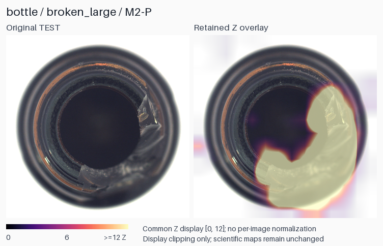
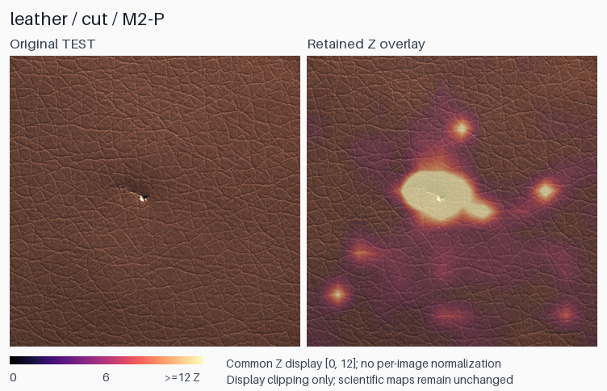
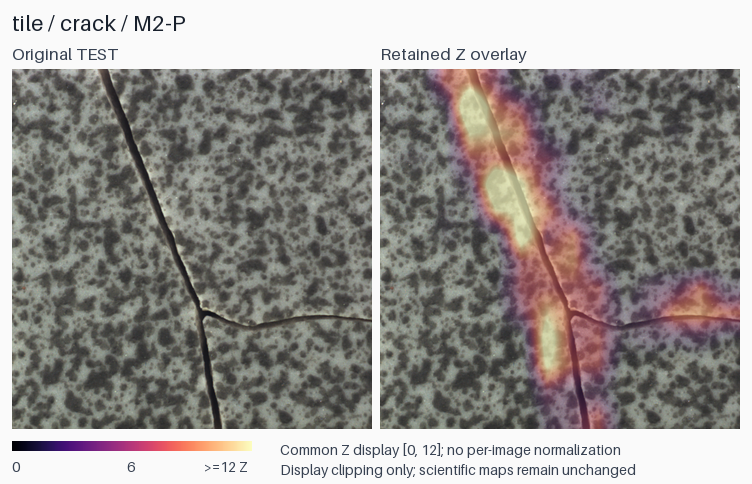
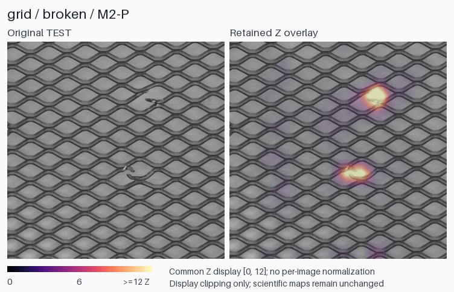
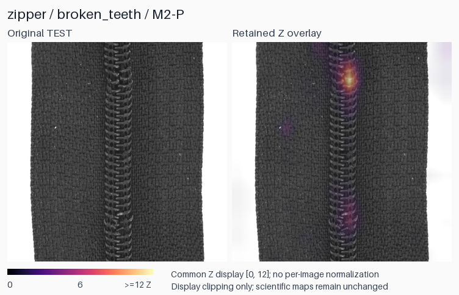

# Anomalib4j

[Italiano](README.md) | **English**

> Java-based anomaly detection for industrial computer vision, with ONNX inference,
> local statistical modeling, reproducible evaluation and CPU performance benchmarking.
> The project shows how a modern visual anomaly-detection pipeline can be integrated into a Java environment with ONNX inference, persistent statistical state, localization and reproducible benchmarking.

- **Java-native inference and evaluation**, built on Java 21 and ONNX Runtime.
- **Frozen MobileNetV4 Conv Small** producing **14x14x96 spatial features**.
- **Normal-only category adaptation**, with no CNN fine-tuning.
- **Evaluated across all 15 MVTec AD categories**, with recorded inputs, metrics
  and real-hardware CPU measurements.

**Selected MVTec AD category results**

| Category | Image AUROC |
|---|---:|
| Bottle | 1.000 |
| Leather | 0.998 |
| Tile | 0.981 |
| Grid | 0.962 |
| Zipper | 0.960 |

**CPU p50:** complete detection **2.90 ms**; Bottle 900x900 localization
**7.42 ms**. [Measurement scope](#cpu-performance).

## The project

Many computer-vision workflows are Python-centric. Anomalib4j integrates pretrained
vision models as software components inside a tested Java application pipeline:
image preprocessing, spatial feature extraction, statistical modeling, model
persistence, anomaly scoring and quantitative evaluation.

Java owns inference and metric evaluation; Python tooling orchestrates campaigns,
numerical parity checks and evidence capture.

## Pipeline

```text
Image
  |
RGB preprocessing / ImageNet normalization
  |
MobileNetV4 Conv Small / ONNX Runtime
  |
14x14x96 spatial descriptors
  |
Local statistical M2 model
  |
Anomaly score + anomaly map
  |
Evaluation / application output
```

M2 models normal appearance at each spatial position:

1. Normalize each local descriptor.
2. Estimate per-position, per-channel mean and sample standard deviation from
   normal **FIT** images.
3. Calibrate local discrepancies using separate held-out **CAL** normal images.
4. Produce a standardized 14x14 anomaly map; its maximum is the image score.

The encoder stays frozen. Category adaptation estimates statistics rather than
optimizing CNN weights. Preprocessing resizes the full RGB image to 224x224 with
bicubic interpolation and applies ImageNet normalization. Z scores are
standardized discrepancies, not probabilities.

[Model definition and numerical validation](docs/benchmark/JAVA_M2_RESULT_20261018.md#selection-and-implementation).

## MVTec AD results

### Selected category results

Representative examples from the validated generic detector, not aggregate values:

| Category | Image AUROC | Pixel AUROC | AUPRO@0.30 |
|---|---:|---:|---:|
| Bottle | 1.000000 | 0.975697 | 0.915738 |
| Leather | 0.998302 | 0.991365 | 0.961311 |
| Tile | 0.980519 | 0.940407 | 0.849164 |
| Grid | 0.961571 | 0.945783 | 0.858965 |
| Zipper | 0.959821 | 0.960991 | 0.882107 |

### Full-dataset aggregate

**Equal-category macro averages across all 15 MVTec AD categories**, using the
generic M2 detector and MobileNetV4 Conv Small:

| Metric | Macro average |
|---|---:|
| Image AUROC | **0.871803** |
| Pixel AUROC | **0.931016** |
| AUPRO@0.30 | **0.805887** |

The evaluation covers 2,900 FIT normals, 729 held-out CAL normals and 1,725 TEST
images. Every category has equal weight; performance varies by category.
Image AUROC measures image ranking, while Pixel AUROC and AUPRO measure
localization. [Evaluation conventions](docs/benchmark/LOCALIZATION_CONVENTIONS.md)
and [full result evidence](docs/EXPERIMENT_INDEX.md#latest-completed-campaigns).

## CPU performance

Direct JMH measurements on **AMD Ryzen AI 9 HX 370 / Windows 11 Pro**, Java 21,
ONNX Runtime 1.30.0. Executed ONNX nodes were verified on
`CPUExecutionProvider`.

| Measured scope | p50 | Mean | p95 |
|---|---:|---:|---:|
| Encoder extraction: preprocessed tensor -> spatial features | **0.641024 ms** | 0.671423 ms | 0.819200 ms |
| Complete generic detection | **2.904064 ms** | 2.910571 ms | 3.637248 ms |
| Complete Bottle 900x900 localization | **7.421952 ms** | 7.280697 ms | 8.812954 ms |

Complete paths start with a predecoded image and a ready model/session. Detection
includes preprocessing, encoder execution, descriptor normalization, M2 and the
image score; localization also produces the 900x900 map. Decode, disk I/O and
model/session loading are excluded. Each complete path is measured directly.

JMH uses one caller, two forks, five 2-second warmups and ten 2-second measurement
iterations per fork. These are desktop request latencies, not camera throughput.
[Detailed benchmark records and reproducibility](docs/EXPERIMENT_INDEX.md#latest-completed-campaigns).

### Same-hardware reference systems

| System | Bottle 900x900 localization p50 |
|---|---:|
| Anomalib4j / MobileNetV4 Small | **7.42 ms** |
| PaDiM | 57.60 ms |
| PatchCore | 247.42 ms |

These are independent complete pipelines on the **same physical hardware**.
The Anomalib 2.6.2 references use ResNet18 for PaDiM and WideResNet50-2 for
PatchCore, with their own pipeline configurations. This is not an equal-backbone
scorer microbenchmark.
Measurement tools and dates differ: the numbers are practical engineering
references, not causal claims about isolated algorithms.

The deployment files are compact: **1,269,313 bytes** for the truncated ONNX
encoder and **304,381 bytes** (about 304 KB) for each serialized category M2
archive. Encoder and category state are stored separately; these are file sizes.

## Visual examples

The examples below show the same generic M2 detector on objects, textures and periodic structures.
All five examples below use the unregistered pipeline.

<table>
<tr>
<td width="50%" align="center">
<strong>Bottle</strong><br>
<br>
<sub>Image AUROC 1.000000 · broken_large</sub>
</td>
<td width="50%" align="center">
<strong>Leather</strong><br>
<br>
<sub>Image AUROC 0.998302 · cut</sub>
</td>
</tr>
<tr>
<td width="50%" align="center">
<strong>Tile</strong><br>
<br>
<sub>Image AUROC 0.980519 · crack</sub>
</td>
<td width="50%" align="center">
<strong>Grid</strong><br>
<br>
<sub>Image AUROC 0.961571 · broken</sub>
</td>
</tr>
<tr>
<td colspan="2" align="center">
<strong>Zipper</strong><br>
<br>
<sub>Image AUROC 0.959821 · broken_teeth</sub>
</td>
</tr>
</table>

Metrics describe the category, not the individual example. Panels pair the
original TEST image with its retained anomaly overlay. All use a fixed display
range **Z [0,12]**, without per-image min/max scaling; clipping affects display
only. [Image identities, map hashes and rendering provenance](docs/assets/readme/README.md).

## Geometric registration

**Positional modeling works best for textures and geometrically consistent or
registered objects.** A displaced normal feature can otherwise meet the wrong
spatial reference.

The Metal Nut extension estimates object pose and canonicalizes sampling before
feature extraction. Fitting, calibration and inference share the same geometric
contract. Its persisted bundle binds geometry, preprocessing, encoder and model
state; invalid geometry is rejected before CNN execution.

This integration is qualified for **Metal Nut**. It exposes native maps and pose
metadata; original-frame overlays are produced by evaluation tooling.
[Registration contract and Java integration](docs/experiments/JAVA_CANONICAL_M2_INTEGRATION.md).

## Engineering highlights

- **Java 21 inference:** reusable ONNX Runtime sessions, ImageNet preprocessing,
  spatial feature extraction and local anomaly maps.
- **Statistical adaptation:** normal-only fitting and independent held-out
  calibration, with explicit descriptor and variance validation.
- **Validated persistence:** versioned binary models reject incompatible encoder
  hashes, preprocessing identities, geometry and invalid numerical state.
- **Dataset and evaluation infrastructure:** metadata-driven labels, deterministic
  FIT/CAL/TEST manifests, original-image geometry and all-15 MVTec AD evaluation.
- **Numerical validation:** Java/Python parity checks for statistics, calibration,
  scores and maps, alongside JUnit tests for contracts and persistence.
- **Performance and reproducibility:** JMH measurements, executed-provider
  profiling, CLI orchestration, source/input hashes and retained result artifacts.

## Quick Start


```shell
git clone https://github.com/ant-ctrl-win/Anomalib4j.git
cd Anomalib4j
mvn -B compile
mvn -B -Pbenchmark '-Dtest=M2BenchmarkSmokeTest' test
```

## Full validation

```shell
mvn -B -Pbenchmark '-Dtest=*Test,!BottleTrainingTest,!BottleRealEvaluationTest' test
```

These commands clone and build the pipeline, run the dataset-free test suite, and execute
a pipeline smoke example. The smoke example uses synthetic image/model fixtures
with real ONNX execution, detection and 900x900 localization. It does not measure
benchmark latency. The two excluded tests require external Bottle data; the
`benchmark` profile compiles the harness without launching a JMH campaign.

For real images, fit or restore a category model first. Full-dataset evaluation
uses the [campaign CLI](tools/ablation/java_m2.py), an external
[DatasetNinja-layout MVTec AD export](docs/benchmark/MVTEC_DATASET_CENSUS.md), and
restored manifests, data hashes and reference outputs. The
[evidence index](docs/EXPERIMENT_INDEX.md) records these prerequisites and artifact
locations. Generated evidence lives in ignored `target/`; preserve it when
reproducing measurements.

## Repository layout

```text
src/main/java/              Java encoder, M2 detector and registration
src/main/resources/models/ ONNX model resources
src/test/java/              Tests, dataset handling and evaluation
src/jmh/java/               JMH benchmarks and CPU-provider verification
tools/                      Campaign, parity and reproducibility utilities
docs/                       Architecture, benchmarks and visual provenance
```

## Further documentation

- [ONNX model and preprocessing contract](docs/architecture/ONNX_MODEL_CONTRACT.md)
- [M2 model and numerical validation](docs/benchmark/JAVA_M2_RESULT_20261018.md#selection-and-implementation)
- [Localization and metric conventions](docs/benchmark/LOCALIZATION_CONVENTIONS.md)
- [Dataset layout and coverage](docs/benchmark/MVTEC_DATASET_CENSUS.md)
- [Evaluation, benchmark evidence and reproducibility index](docs/EXPERIMENT_INDEX.md)

## License

Code: [Apache License 2.0](LICENSE).

Gallery figures are resized and overlaid adaptations of MVTec AD images,
attributed to **MVTec Software GmbH**, and distributed under
[CC BY-NC-SA 4.0](https://creativecommons.org/licenses/by-nc-sa/4.0/).
[Sources, transformations and attribution](docs/assets/readme/README.md).
The dataset is obtained separately.
