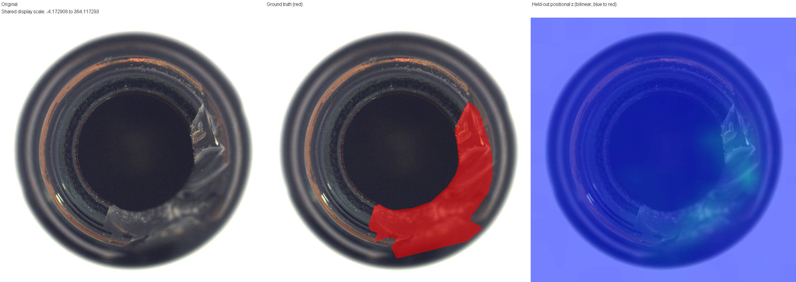
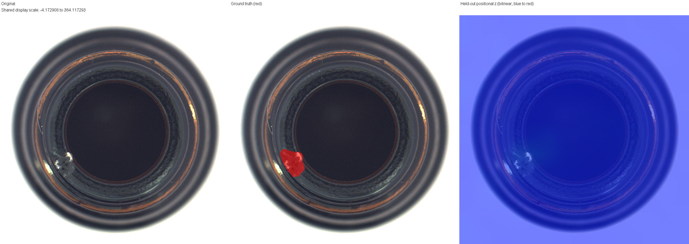
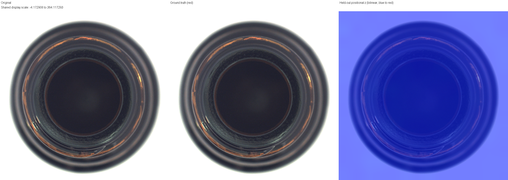
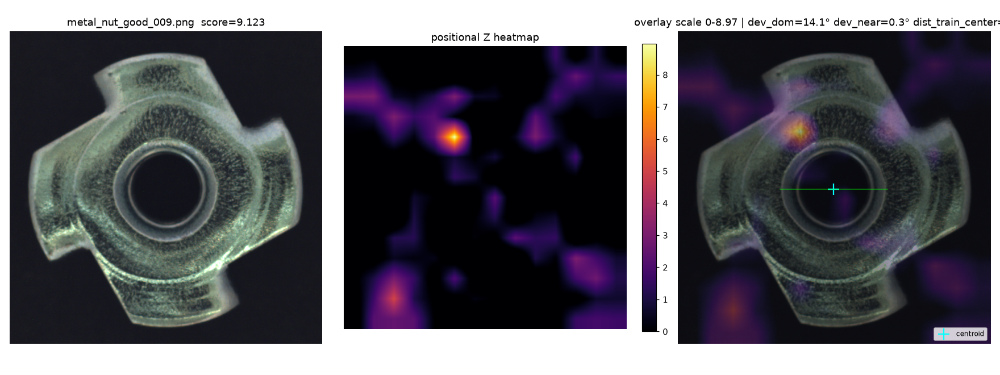

# Anomalib4j

**Apprendere una memoria visuale nello spazio VSA e compilarne lo scoring direttamente nelle feature CNN.**

Un progetto sperimentale in **Java 21 e ONNX Runtime** che studia la compilazione tramite Adjoint in una pipeline CNN + Vector Symbolic Architecture. L'anomaly detection industriale è il banco di prova: immagini, heatmap e misure riproducibili rendono visibile il risultato.

- **Equivalenza verificata:** scoring VSA esplicito e filtri compilati concordano con errori nell'ordine di `10^-12` sui dati reali testati.
- **Inferenza economica:** il kernel compilato valuta le 196 posizioni in circa **12 µs**, senza proiezione a 10.000 dimensioni durante l'inferenza.
- **Un risultato applicativo concreto:** su Bottle, Image AUROC **1.000**; il detector gira a circa **3,72 ms p50**, mentre la pipeline completa produce la heatmap **900×900** in **9,49 ms p50** su CPU, cioè oltre 100 FPS.

[Idea](#lidea-centrale-compilare-lo-score) · [Risultati](#benchmark-su-mvtec-ad) · [Heatmap](#esempi-qualitativi) · [Riproducibilità](#riproducibilità) · [Documentazione](#documentazione)

## Perché esiste questo progetto

Anomalib4j nasce da precedenti esperimenti visuali neuro-simbolici: una CNN estrae le feature, una proiezione le porta nello spazio VSA e una memoria di archetipi permette il confronto con esempi già acquisiti.

```text
immagine -> CNN -> feature -> proiezione VSA -> confronto con la memoria
```

La proiezione CNN → VSA rappresentava una parte importante del costo. La domanda iniziale era quindi molto precisa: **possiamo trasformare il modello VSA appreso in uno scorer equivalente, applicabile direttamente alle feature CNN normalizzate?**

Questo repository raccoglie la derivazione, l'implementazione e la verifica di quel passaggio. L'anomaly detection è stata scelta per valutarlo su un compito visuale misurabile. Il confronto con Anomalib, PaDiM e PatchCore è arrivato successivamente, per collocare il prototipo rispetto a sistemi esistenti.

## L'idea centrale: compilare lo score

Durante l'apprendimento si costruiscono statistiche e archetipi nello spazio VSA. L'Adjoint della proiezione trasferisce poi il confronto con ciascun archetipo in un filtro nello spazio CNN.

```text
COSTRUZIONE DELLA MEMORIA

feature CNN normalizzate
    -> proiezione casuale a 10.000 dimensioni
    -> statistiche VSA e standardizzazione
    -> accumulo degli esempi in archetipi nominali
    -> compilazione Adjoint
    -> filtri nello spazio CNN

INFERENZA

immagine -> CNN -> feature normalizzate -> filtri compilati -> score
```

La relazione essenziale è:

```text
Aᵀ ((R x_norm / √D − μ) / σ) = Wᵀ x_norm + b
```

Il filtro incorpora proiezione, statistiche congelate e archetipo. La normalizzazione delle feature resta nel calcolo; **la proiezione VSA non viene più eseguita in inferenza**.

L'equivalenza riguarda lo **score**, ossia il funzionale lineare applicato alla rappresentazione. Non richiede una biiezione fra spazi né una ricostruzione inversa della feature CNN.

La verifica sulle 83 immagini Bottle dello Sprint 7 ha confrontato **16.268 celle**, con errore assoluto massimo **1,31 × 10^-12**. Sullo stesso esperimento, il confronto interno dopo l'encoder misurava circa **651 ms** per lo scoring VSA esplicito e **13 µs** per quello compilato; la successiva misura JMH del kernel è circa **12 µs**. Sono costi dello scoring, distinti dalla latenza dell'intera pipeline e dal confronto con altri metodi.

Dettagli: [equivalenza e benchmark interno](docs/development/SPRINT7_RESULT.md), [misure JMH](docs/development/PERFORMANCE_BASELINE_RESULT.md), [condizioni matematiche della compilazione](docs/architecture/FUTURE_ARCHITECTURE_ROADMAP.md#151-mathematical-clarification-of-cnnvsa-compiled-equivalence).

## Architettura: gli “occhi” e la memoria

La CNN è gli **occhi** del sistema: trasforma l'immagine in feature. La memoria e il detector lavorano su ciò che questi occhi rendono disponibile.

Per mantenere l'esperimento focalizzato su Adjoint, il backbone è un **MobileNetV4 preaddestrato e congelato**, senza fine-tuning su MVTec o sulle categorie industriali. Le feature non sono quindi ottimizzate per questo specifico dominio.

Il detector è una baseline sperimentale volutamente semplice:

```text
MobileNetV4 frozen
    -> feature map 14×14×96
    -> 196 descrittori locali
    -> un archetipo nominale per posizione
    -> scoring Adjoint compilato
    -> raw = 1 − score
    -> calibrazione Z posizionale held-out
    -> heatmap + massimo come score dell'immagine
```

La calibrazione stima media e deviazione standard dei raw score su immagini normali separate da quelle usate per apprendere gli archetipi. La heatmap scientifica conserva i valori Z senza clamp; l'upsampling bilineare la porta alla risoluzione originale.

| Componente | Scelta corrente |
|---|---|
| Runtime | Java 21, ONNX Runtime 1.30.0, CPU |
| Input CNN | RGB 224×224, resize bicubic, normalizzazione ImageNet |
| Feature | SPATIAL_14, layout HWC, 14×14×96 |
| Memoria | Archetipi VSA continui, senza binarizzazione |
| Proiezione in apprendimento | Rademacher, D = 10.000, seed 42 |
| Scoring | Filtri Adjoint sulle feature normalizzate |
| Valutazione | Image AUROC, Pixel AUROC, AUPRO@0.30 |

## Memoria incrementale e archetipi

**Un nuovo esempio aggiorna la memoria, non gli occhi.** Separare backbone e memoria rende naturale incorporare nuovi esempi negli archetipi **senza backpropagation della CNN**, quindi ricompilare i filtri. È una motivazione architetturale importante della linea CNN + VSA, compatibile con archetipi creati al momento, pochi esempi e aggiornamenti incrementali.

Con encoder, proiezione e statistiche fissi, la memoria può accumulare nuove osservazioni nello stesso spazio. Per continuare correttamente servono gli accumulatori e i conteggi; cambiamenti alle statistiche richiedono una gestione coerente della memoria e della calibrazione.

Il backbone congelato evita la sovrascrittura dei suoi pesi tipica del continual fine-tuning, eliminando una delle sorgenti classiche di catastrophic forgetting. **Questo benchmark non dimostra però una soluzione generale al continual learning:** interferenza nella memoria, qualità few-shot e comportamento nel tempo non sono stati misurati qui.

## Benchmark su MVTec AD

Confronto CPU sullo stesso hardware fra Anomalib4j e le implementazioni **Anomalib 2.6.2** di PaDiM e PatchCore. Run finale: `final-comparison-20261003`.

### Qualità

Valori maggiori sono migliori. Image AUROC misura la separazione fra immagini sane e difettose; Pixel AUROC valuta i pixel; AUPRO@0.30 valuta la copertura delle regioni anomale fino a un false-positive rate di 0,30.

| Categoria | Metodo | Image AUROC | Pixel AUROC | AUPRO@0.30 |
|---|---|---:|---:|---:|
| Bottle | **Anomalib4j** | **1.000** | **0.962** | **0.877** |
| Bottle | PaDiM | 0.998 | 0.978 | 0.922 |
| Bottle | PatchCore | 1.000 | 0.985 | 0.944 |
| Metal Nut | **Anomalib4j** | **0.758** | **0.693** | **0.380** |
| Metal Nut | PaDiM | 0.952 | 0.941 | 0.851 |
| Metal Nut | PatchCore | 0.998 | 0.987 | 0.940 |

### Latenza CPU: detector e localizzazione a piena risoluzione

Mediana p50, batch 1, immagine già decodificata in RAM. Il solo percorso di detection Anomalib4j è circa **3,72 ms** su Bottle e **3,70 ms** su Metal Nut. La tabella seguente usa invece il confronto più completo: preprocessing, encoder, detector e produzione della mappa alla risoluzione originale; esclude caricamento file, costruzione del modello ed evaluator. Su Bottle, **9,49 ms** per una heatmap 900×900 corrispondono a oltre 100 elaborazioni al secondo.

| Categoria | Risoluzione finale | Anomalib4j | PaDiM | PatchCore |
|---|---|---:|---:|---:|
| Bottle | 900×900 | **9,49 ms** | 57,60 ms | 247,42 ms |
| Metal Nut | 700×700 | **5,78 ms** | 44,46 ms | 222,93 ms |

Hardware: **AMD Ryzen AI 9 HX 370**, Windows 11. JMH per Java e harness Python per i competitor, con warm-up e misure ripetute su due processi/fork.

Il confronto riguarda sistemi nativi: MobileNetV4 per Anomalib4j, ResNet18 per PaDiM e Wide ResNet50-2 per PatchCore, con i rispettivi preprocessing. Anomalib4j usa 167 immagini per apprendimento + 42 per calibrazione su Bottle, 176 + 44 su Metal Nut; i competitor usano tutte le 209/220 normali per il fit. I test comprendono 83 e 115 immagini. Le metriche sono calcolate con un evaluator comune.

Il risultato è un **compromesso qualità/latenza misurato**, non una superiorità generale. Il vantaggio end-to-end include anche le differenze di backbone e runtime; non è attribuibile interamente all'Adjoint. Protocollo, p95/p99, fitting e memoria sono nel [report completo](docs/benchmark/BENCHMARK_FINAL_RESULT.md).

## Esempi qualitativi

Le immagini mostrano il comportamento del prototipo e servono come visualizzazione qualitativa, non come prova statistica. Nelle tavole Bottle il pannello centrale mostra la ground truth in rosso; le scale cromatiche Bottle e Metal Nut sono diverse e non rappresentano probabilità.

<p align="center">
  
</p>

**Bottle · broken_large_000** — La risposta segue parte della frattura estesa sul bordo destro e inferiore.

<p align="center">
  
</p>

**Bottle · broken_small_000** — Una piccola scheggiatura mostra il livello di dettaglio del caso e la risposta locale sulla griglia grossolana.

<p align="center">
  
</p>

**Bottle · good_000** — Un esempio sano con risposta contenuta sulla scala condivisa degli esempi Bottle.

<p align="center">
  
</p>

**Metal Nut · good_009** — Un pezzo sano produce un'attivazione interna marcata: un esempio concreto del limite della configurazione corrente.

Le immagini pubblicate nel README devono essere copiate dagli artefatti locali in `docs/images/`; `target/` resta esclusa dal repository.

## Cosa ha funzionato, e dove si vedono i limiti

**Adjoint ha raggiunto l'obiettivo iniziale:** la derivazione è diventata codice Java e lo score compilato è stato verificato contro il percorso esplicito su feature sintetiche e immagini reali. La proiezione VSA è uscita dalla hot path.

**Bottle mostra il potenziale del prototipo.** La separazione è già forte prima della calibrazione: Image AUROC RAW circa 0.986. La Z la porta a 1.000, con Pixel AUROC circa 0.962. Un detector semplice può quindi sfruttare efficacemente feature preaddestrate senza fine-tuning specifico.

**Metal Nut mostra il limite della combinazione attuale di feature e memoria locale.** Il RAW è già debole; la Z migliora l'aggregato, ma non colma il divario. Posa e rotazione non risultano la causa dominante nelle analisi svolte, e gli effetti bordo/sfondo non spiegano il risultato complessivo. Difetti di forma come `bent` evidenziano la difficoltà di un modello senza un ramo esplicito regionale o globale.

Questo non implica che MobileNetV4 produca feature deboli in generale: qui non sono state ottimizzate per il dominio. La capacità del singolo archetipo e l'aggregazione contribuiscono anch'esse al risultato. Le diagnosi sono raccolte nei report [Bottle](docs/diagnostics/BOTTLE_SYMMETRIC_DIAGNOSTIC.md), [Metal Nut RAW/Z](docs/diagnostics/METAL_NUT_RAW_VS_Z_DIAGNOSTIC.md) e [bordo](docs/diagnostics/BORDER_EXCLUSION_SENSITIVITY.md).

## Cosa abbiamo imparato

Nel caso corrente — proiezione lineare, superposizione degli esempi, statistiche congelate e readout lineare — gran parte del percorso si può ricondurre allo spazio delle feature CNN. **L'espansione a 10.000 dimensioni non è, da sola, il valore dimostrato.**

Questo apre una possibilità emersa durante il progetto: costruire in futuro almeno una parte della memoria direttamente nello spazio delle feature CNN. In questo modo si potrebbe eliminare anche il costo offline della proiezione ad alta dimensionalità e semplificare ulteriormente la pipeline. Sarebbe però un diverso processo di apprendimento: il possibile beneficio sulla qualità deve essere verificato. L'Adjoint attuale, invece, conserva esattamente lo score appreso e ne riduce il costo di inferenza.

La distinzione utile è fra quattro livelli:

| Livello | Ruolo |
|---|---|
| **Rappresentazione** | Quali informazioni la CNN rende accessibili |
| **Memoria** | Come esempi e archetipi descrivono il soggetto |
| **Inferenza compilata** | Come applicare lo stesso score con meno lavoro |
| **Operazioni VSA** | Come comporre, associare e interrogare rappresentazioni |

Bundling, archetipi e aggiornamenti incrementali restano interessanti. Binding, memorie multimodali e operazioni simboliche o relazionali offrono altre motivazioni per la VSA, oltre alla semplice espansione dimensionale. Il loro vantaggio specifico richiede confronti dedicati; non deriva automaticamente dai risultati di questo benchmark.

## Sviluppi futuri

Le direzioni delineate per una possibile v2 riguardano soprattutto la qualità delle feature e il modello di memoria:

- scegliere layer, sottospazi o adapter in funzione del compito e delle variazioni nominali;
- valutare rappresentazioni locali e regionali complementari con una singola CNN;
- confrontare detector diversi sulle stesse feature multiscala;
- studiare aggiornamenti few-shot/incrementali e operazioni compositive della memoria.

Sono prospettive successive alla validazione Adjoint, non obiettivi già raggiunti. La [roadmap tecnica](docs/architecture/FUTURE_ARCHITECTURE_ROADMAP.md) distingue proprietà matematiche, ipotesi e possibili esperimenti, senza modificare il benchmark congelato.

## Riproducibilità

Il core usa **Java 21, Maven e ONNX Runtime**; i test sono in JUnit 5. JMH misura i percorsi Java. Il confronto esterno usa un ambiente Python separato con Anomalib 2.6.2 e pesi identificati tramite hash.

Per eseguire soltanto un gruppo mirato di test algebrici e di memoria, senza training sulle immagini reali:

```shell
mvn -B "-Dtest=AdjointEquivalenceTest,DenseRademacherProjectionTest,ProjectionStatisticsAccumulatorTest,PositionalMemoryBuilderTest" test
```

Il normale `mvn test` include anche test su dati reali e non va considerato uno smoke rapido. Il dataset MVTec AD / DatasetNinja è esterno al repository. I runner del confronto sono stati validati nel workspace Windows documentato; percorsi, ambiente e comandi completi sono nelle [istruzioni di esecuzione](docs/benchmark/BENCHMARK_PHASE2_IMPLEMENTATION.md) e nella [preparazione dell'ambiente](docs/benchmark/BENCHMARK_PRERUN_VERIFICATION.md).

Il run finale conserva manifest, split, hash, stato dei modelli, mappe lossless, predizioni e campioni di latenza sotto `target/comparison/final-comparison-20261003/`. È una directory locale di evidenze, esclusa da Git: `mvn clean` la eliminerebbe. I report Markdown riportano i risultati e i riferimenti agli artefatti.

## Una linea di progetti CNN + VSA

Anomalib4j si inserisce in una linea di esperimenti che comprende il progetto Java VSA su PlantVillage, l'app Android / VisionSector, VisionSectorHub e altri lavori CNN + VSA. Qui il tema specifico è la **compilazione Adjoint della memoria in uno scorer sulle feature CNN**.

I singoli progetti e i loro risultati saranno documentati separatamente. *TODO: aggiungere i link ai repository correlati quando disponibili.*

## Documentazione

| Per approfondire | Documento |
|---|---|
| Stato e architettura | [PROJECT_STATE](docs/PROJECT_STATE.md) |
| Equivalenza su immagini reali | [Sprint 7](docs/development/SPRINT7_RESULT.md) |
| Protocollo comparativo | [BENCHMARK_CONTRACT](docs/benchmark/BENCHMARK_CONTRACT.md) |
| Risultati, latenza, fitting e memoria | [BENCHMARK_FINAL_RESULT](docs/benchmark/BENCHMARK_FINAL_RESULT.md) |
| Convenzioni di localizzazione | [LOCALIZATION_CONVENTIONS](docs/benchmark/LOCALIZATION_CONVENTIONS.md) |
| Calibrazione held-out | [HELDOUT_CALIBRATION_RESULT](docs/benchmark/HELDOUT_CALIBRATION_RESULT.md) |
| Coordinate e attivazioni spaziali | [SPATIAL_EDGE_ARTIFACT_AUDIT](docs/diagnostics/SPATIAL_EDGE_ARTIFACT_AUDIT.md) |
| Direzioni future e limiti della compilazione | [FUTURE_ARCHITECTURE_ROADMAP](docs/architecture/FUTURE_ARCHITECTURE_ROADMAP.md) |
