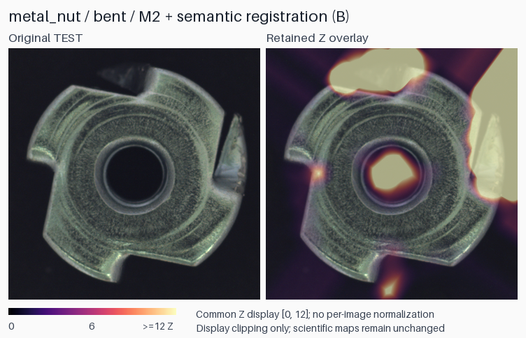
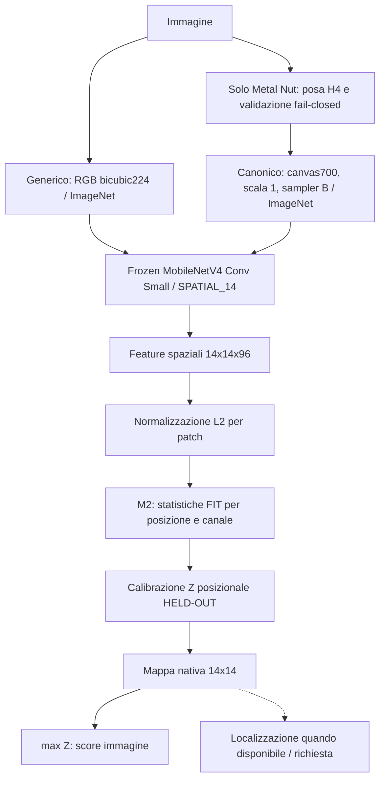

# Anomalib4j

**Anomalib4j è un detector di anomalie visuali in Java basato su feature CNN
spaziali e modellazione statistica locale, con supporto alla registrazione
geometrica degli oggetti per mantenere la corrispondenza semantica tra regioni
dell'immagine.**

Apprende esclusivamente da campioni normali e produce sia uno **score di anomalia
a livello immagine** sia una **mappa spaziale delle regioni anomale**.

### Backbone leggero, nessun fine-tuning

La v1 usa un **cut spaziale intermedio 14x14x96 di MobileNetV4 Conv Small** come
feature extractor, al posto dell'output del classificatore. Il backbone CNN
preaddestrato è **completamente congelato**: nessun fine-tuning su MVTec AD,
nessuna backpropagation, nessuna ottimizzazione basata su gradienti e nessun peso
CNN specifico per categoria.

Il «training» di M2 è un fitting statistico: forward pass sui campioni normali,
stima della media e della deviazione standard campionaria dei descrittori locali
normalizzati sui campioni FIT, poi calibrazione posizionale alpha/beta su normali
HELD-OUT separati. L'adattamento a una nuova categoria non richiede il
riaddestramento del backbone.

Il detector M2 a corrispondenza stretta (**M2-P**) è stato valutato sulle 15
categorie di MVTec AD, ottenendo risultati particolarmente elevati su categorie
visivamente molto diverse:

- **Bottle:** Image AUROC **1.000000**
- **Leather:** Image AUROC **0.998302**
- **Tile:** Image AUROC **0.980519**
- **Grid:** Image AUROC **0.961571**
- **Zipper:** Image AUROC **0.959821**

## Esempi su categorie diverse

Oggetti, texture, strutture periodiche e difetti locali: tutti i cinque esempi
seguenti usano **lo stesso detector M2-P generico**, senza registrazione.

<table>
<tr>
<td width="50%" align="center">
<strong>Leather · Image AUROC 0.998302</strong><br>
<br>
<sub>Pixel AUROC 0.991365 · AUPRO@0.30 0.961311<br>cut · leather_cut_000.png</sub>
</td>
<td width="50%" align="center">
<strong>Bottle · Image AUROC 1.000000</strong><br>
<br>
<sub>Pixel AUROC 0.975697 · AUPRO@0.30 0.915738<br>broken_large · bottle_broken_large_000.png</sub>
</td>
</tr>
<tr>
<td width="50%" align="center">
<strong>Tile · Image AUROC 0.980519</strong><br>
<br>
<sub>Pixel AUROC 0.940407 · AUPRO@0.30 0.849164<br>crack · tile_crack_000.png</sub>
</td>
<td width="50%" align="center">
<strong>Grid · Image AUROC 0.961571</strong><br>
<br>
<sub>Pixel AUROC 0.945783 · AUPRO@0.30 0.858965<br>broken · grid_broken_000.png</sub>
</td>
</tr>
<tr>
<td colspan="2" align="center">
<strong>Zipper · Image AUROC 0.959821</strong><br>
<br>
<sub>Pixel AUROC 0.960991 · AUPRO@0.30 0.882107<br>broken_teeth · zipper_broken_teeth_000.png</sub>
</td>
</tr>
</table>

**Le metriche descrivono la categoria, non la singola immagine mostrata.**
Image AUROC 1.0 su Bottle non implica mappe perfette: Pixel AUROC e AUPRO
misurano aspetti diversi della localizzazione.

Ogni card affianca il TEST originale e la sua mappa Z conservata. Tutte e sei
le card, inclusa Metal Nut sotto, usano la stessa scala di visualizzazione
**Z [0, 12]**: valori negativi trasparenti, valori >=12 saturati, colormap magma,
opacità crescente fino a 0.65. Nessuna normalizzazione min/max per immagine;
il clipping riguarda solo il display. Z non è una probabilità e la scala
comune non rende identiche le distribuzioni delle categorie.
[Provenienza e rendering](docs/assets/readme/README.md), con percorsi e hash
di immagini, mappe e metriche. Figure derivate da MVTec AD, MVTec Software GmbH,
[CC BY-NC-SA 4.0](https://creativecommons.org/licenses/by-nc-sa/4.0/).

## Estensione: M2 + registrazione semantica

**M2 + semantic registration**, variante canonica **B**, è un'estensione
specifica di Metal Nut, distinta dal M2-P generico della galleria.

<p align="center">
<strong>Metal Nut · Image AUROC 0.960899</strong><br>
<br>
<sub>Pixel AUROC 0.886602 · AUPRO@0.30 0.646812<br>bent · metal_nut_bent_000.png · metriche di categoria</sub>
</p>

La forma a simmetria quadrupla permette di stimare orientamento tramite armonica
angolare **H4** e centroide. Il contratto usa sorgente/canvas 700x700, scala 1 e
sampler **B bilineare diretto** verso il tensore 224. M2 viene nuovamente
fittato/calibrato in queste coordinate; FIT, CAL e inferenza condividono il percorso.

| Metal Nut | Image AUROC | Pixel AUROC | AUPRO@0.30 |
|---|---:|---:|---:|
| M2 non allineato | 0.845552 | 0.849318 | 0.624208 |
| Canonico B | **0.960899** | **0.886602** | **0.646812** |

Il cosine medio nella stessa posizione passa circa da 0.548 a 0.870; migliora
fortemente anche la diagnostica controllata di rotazione delle sorgenti.
Sono risultati della categoria/split osservati, non robustezza universale.
Il bundle distinto valida contratto di preprocessing, encoder e stato; geometria
non valida causa errore prima della CNN, senza fallback non allineato o score
da buffer precedente. [Contratto e integrazione Java](docs/experiments/JAVA_CANONICAL_M2_INTEGRATION.md).

## Risultati complessivi

Oltre ai casi mostrati sopra, M2 è stato valutato sull'intero insieme delle
**15 categorie MVTec AD**.

| Metrica | Macro-media |
|---|---:|
| Pixel AUROC | **0.931** |
| AUPRO@0.30 | **0.806** |
| Image AUROC | **0.872** |

Le macro-medie attribuiscono lo stesso peso a ciascuna categoria e comprendono
quindi sia i casi in cui il detector raggiunge prestazioni prossime alla
separazione perfetta, sia le categorie più difficili per l'attuale rappresentazione.

I risultati completi per categoria e le campagne sperimentali sono disponibili
nell'[indice degli esperimenti](docs/EXPERIMENT_INDEX.md).

## Architettura: feature congelate, modello locale stretto

Il percorso generico ridimensiona l'intera immagine RGB a 224x224 con bicubic,
senza crop/letterboxing, e applica la normalizzazione ImageNet. L'encoder
MobileNetV4 Conv Small SPATIAL_14 produce 196 descrittori da 96 canali. La
registrazione qualificata di Metal Nut usa invece un proprio contratto di sampling diretto.

**M2 è backbone-agnostic a livello algoritmico:** opera su una griglia di
descrittori spaziali e non dipende dalla particolare architettura CNN. La v1 Java
è attualmente implementata, contrattualizzata e validata con **MobileNetV4 Conv
Small SPATIAL_14 (14x14x96)**. Sostituire l'encoder richiede un contratto di feature
spaziali compatibile, gli adeguamenti dell'integrazione Java e un nuovo fit con
calibrazione del modello M2. [Contratto dell'encoder](docs/architecture/ONNX_MODEL_CONTRACT.md).



Screw non appartiene al ramo canonico di produzione. Per Metal Nut il risultato
può conservare mappa nativa e trasformazione; la localizzazione/backprojection
nel frame originale resta nel tooling di qualificazione, non nell'API di produzione.

M2 modella ogni canale indipendentemente, con media e deviazione standard
campionaria specifiche della posizione. FIT costruisce il modello; normali
separati HELD-OUT stimano alpha/beta per la calibrazione:

```text
u[p]     = x[p] / ||x[p]||
mu[p,c]  = mean_FIT(u[p,c])
s[p,c]   = max(sampleStd_FIT(u[p,c]), 1e-6)
raw[p]   = mean_c(((u[p,c] - mu[p,c]) / s[p,c])^2)
alpha[p] = mean_CAL(raw[p])
beta[p]  = max(sampleStd_CAL(raw[p]), 1e-6)
Z[p]     = (raw[p] - alpha[p]) / beta[p]
score    = max_p Z[p]
```

Descrittori non finiti o con norma inferiore a 1e-6 sono rifiutati. Gli score non
sono clamped: **Z è una standardizzazione, non una probabilità** né una garanzia
sul tasso operativo di falsi allarmi. M2 usa statistiche diagonali, non una
covarianza completa; non esegue proiezione VSA o scoring Adjoint.

## Build, utilizzo e riproducibilità

Requisiti definiti in `pom.xml`: **JDK 21**, Maven 3.x, ONNX Runtime CPU **1.30.0**,
JUnit Jupiter **5.11.4**; il profilo `benchmark` aggiunge JMH **1.37**.
Le dipendenze Maven devono essere scaricabili o già disponibili nella cache.
Dalla radice del repository, compilazione del codice principale:

```shell
mvn -B compile
```

Suite con fixture sintetiche/risorse incluse, escludendo i due test storici su
Bottle reale (il profilo compila anche i sorgenti JMH, senza avviare benchmark):

```shell
mvn -B -Pbenchmark "-Dtest=*Test,!BottleTrainingTest,!BottleRealEvaluationTest" test
```

Il semplice `mvn test` include anche quei test real-data e non è il comando
dataset-free.
### Usare il detector Java

L'encoder è incluso; un modello nominale M2 per categoria deve essere costruito
o ripristinato separatamente. Frammento di integrazione, con `image` già decodificata
come `BufferedImage` e `modelPath` percorso a un archivio M2 generico valido:

```java
import io.github.antctrlwin.anomalib4j.m2.M2Detector;
import io.github.antctrlwin.anomalib4j.m2.M2Model;
import io.github.antctrlwin.anomalib4j.m2.M2ModelStore;

var model = M2ModelStore.read(modelPath, M2ModelStore.encoderHash());
try (var detector = new M2Detector(model)) {
    double[] nativeZ = detector.nativeMap(image);
    double imageScore = M2Model.imageScore(nativeZ);
}
```

Lo score usa questa stessa mappa, senza seconda estrazione CNN. Per Metal Nut
servono il bundle e le API canoniche distinte; non si carica quel bundle come
modello generico. I detector mantengono stato/sessioni riutilizzabili; il percorso
canonico è sequenziale e richiede istanze separate o serializzazione esterna.

**Tre livelli di riproducibilità:**

- **Clone normale:** compilazione, test sintetici e encoder/fixture inclusi.
  Non contiene automaticamente un detector già fittato per una categoria.
- **Dataset esterno:** campagne FIT/CAL/TEST richiedono MVTec AD nell'export
  DatasetNinja usato dal progetto: `meta.json`, `train/img`, `train/ann`,
  `test/img`, `test/ann`; file `categoria_difetto_indice.png` e annotazioni
  `.png.json`. Il layout MVTec nativo non è accettato direttamente.
  Dati non distribuiti qui: ottenerli separatamente secondo le relative condizioni.
  [Layout verificato](docs/benchmark/MVTEC_DATASET_CENSUS.md).
- **Evidenza storica:** molte campagne dipendono anche da output ignorati in
  `target/`: descrittori, mappe, bundle, manifest e sorgenti congelati.
  I report da soli non ricreano questi dati. Le identità sorgente misurate
  differiscono da HEAD; parità numerica non significa identità dei sorgenti.
  Il pacchetto completo di ripristino non è ancora definito.

Comandi e prerequisiti specifici sono nei report indicizzati, incluso il
[report Java M2](docs/benchmark/JAVA_M2_RESULT_20261018.md). Alcuni runner verificano
rigidamente gli hash storici: un checkout corrente non sostituisce lo snapshot
richiesto. I workflow comparativi sono stati eseguiti su Windows e possono
richiedere PowerShell/Python e dipendenze specifiche. Non sono campagne turnkey
da un clone. **Non usare `mvn clean` in un workspace che conserva evidenze.**

## Prestazioni CPU dell'estensione Metal Nut

**Prestazioni: ultimo confronto diretto e appaiato Metal Nut**, millisecondi per
operazione, JMH su Ryzen AI 9 HX 370 / Windows 11, un chiamante, due fork:

| Percorso completo score-only | p50 | Media | p95 |
|---|---:|---:|---:|
| Comparatore con acquisizione pixel generica | 10.272768 ms | 10.173606 ms | 12.992512 ms |
| Fast path TYPE_3BYTE_BGR con controlli | **4.423680 ms** | **4.363740 ms** | **5.816320 ms** |

Immagini già decodificate e residenti in memoria, CPU desktop misurata, solo
decisione: esclusi acquisizione camera, decode, I/O, caricamento modello/sessione
e localizzazione di produzione. **Non è una misura di FPS del sistema/camera.**
Il comparatore usa lo stesso detector con acquisizione pixel generica; il fast
path conserva i valori e usa fallback sui raster non supportati. Profili separati
verificano nodi ONNX eseguiti su CPUExecutionProvider. Le variazioni fra fork/host
limitano l'estensione del risultato. [Parità e misure BGR](docs/experiments/JAVA_CANONICAL_BGR_FAST_PATH.md).

## Repository e confini delle API

Percorsi Java sotto `io/github/antctrlwin/anomalib4j/`:

```text
src/main/java/.../
  onnx/          encoder e preprocessing
  m2/            M2 generico, training e persistenza
  canonical/     Metal Nut: geometria, sampler, bundle e detector
  projection/    riferimento M0, insieme a memory/adjoint/training/...
src/test/java/.../
  evaluation/    campagne, metriche, controlli e qualificazione Screw
  .../           test sintetici, parità e persistenza
src/jmh/java/.../ benchmark JMH di encoder, geometria e detector
src/main/resources/models/ encoder ONNX SPATIAL_14 e SPATIAL_28
tools/           orchestrazione Python di confronto/ablazione/robustezza
docs/            stato, protocolli, report e fixture conservate
target/          output/evidenze locali generati e ignorati da Git
```

Parte sostanziale della ricerca vive intenzionalmente nei sorgenti di test:
non costituisce un'API pubblica di inferenza.

| Componente | Stato |
|---|---|
| M2 generico stretto | Detector Java selezionato |
| M0 VSA/Adjoint | Legacy/riferimento |
| Metal Nut M2 canonico | Estensione integrata qualificata entro il contratto |
| Canonicalizzazione Screw | Sperimentale / MIXED |
| Corrispondenza N1/G | Controlli sperimentali |
| Framework universale di posa | Non implementato |
| Modello locale con covarianza | Ipotesi futura non testata |
| Fusione multimodale VSA | Ipotesi futura separata |

## Ambito e limiti

- La qualità varia fra categorie; Screw e Hazelnut sono fra i casi più deboli.
  Gli split MVTec sono già osservati; manca una validazione indipendente su
  acquisizioni reali.
- La registrazione rigida è specifica per categoria; solo Metal Nut ha un percorso
  canonico integrato e qualificato. Non esiste un framework universale di posa.
- M2 diagonale ignora la covarianza fra canali; il percorso generico resta sensibile
  al disallineamento. Robustezza fotometrica incompleta; riflessi/glare locali non testati.
- La localizzazione/backprojection canonica di produzione resta differita.
  Per i dettagli: [sintesi della ricerca](docs/ANOMALIB4J_RESEARCH_SYNTHESIS.md)
  e [indice esperimenti](docs/EXPERIMENT_INDEX.md).

### Registrazione oltre Metal Nut

Screw verifica una seconda geometria, con asse principale e polarità testa/punta.
Nel controllo appaiato, Image/Pixel AUROC/AUPRO passano da
**0.564870 / 0.864740 / 0.607138** (identità) a
**0.663456 / 0.961903 / 0.845029** (canonico).
Il sottogruppo `scratch_head` peggiora: il percorso resta **research-only / MIXED**,
non una seconda categoria qualificata.
[Controllo e popolazioni appaiate](docs/experiments/SCREW_B_IDENTITY_M2_CONTROL.md).

<details>
<summary><strong>Contesto di ricerca: ablazioni M0/C1/V1/M2 e contributo VSA/Adjoint</strong></summary>

### Confronto scientifico su MVTec AD

**Benchmark scientifico conservato, tutte le 15 categorie, macro-medie con uguale
peso per categoria.** Non è un confronto con tutti i detector esterni disponibili.
Image/Pixel AUROC misurano la separazione a livello immagine/pixel; AUPRO valuta
la copertura delle regioni difettose fino a false-positive rate 0.30.

| Modello | Image AUROC | Pixel AUROC | AUPRO@0.30 |
|---|---:|---:|---:|
| M0 | 0.818690 | 0.807989 | 0.575592 |
| C1 | 0.831351 | 0.866853 | 0.682340 |
| V1 | 0.830704 | 0.866527 | 0.681510 |
| M2 | **0.871803** | **0.931016** | **0.805887** |

M0 è il baseline Java conservato; C1/V1/M2 sono l'ablazione scientifica Python
sulle stesse feature Java, split ed evaluator. C1 usa un centroide cosine locale;
V1 il cosine dopo proiezione Rademacher a 10.000 dimensioni. V1 non migliora
nessuna delle tre macro rispetto a C1; M2, sensibile alla dispersione locale,
è il modello selezionato. L'ordinamento non implica superiorità per ogni categoria
o significatività statistica.

Il port Java M2 riproduce le tre metriche Python su Bottle, Metal Nut e Hazelnut
con delta riportati pari a zero. **Non viene dichiarata una seconda campagna
TEST-quality Java M2 su tutte le 15 categorie.** L'[indice esperimenti](docs/EXPERIMENT_INDEX.md)
distingue qualità, parità e diagnostiche di robustezza, con le rispettive fonti.

### VSA/Adjoint e corrispondenza spaziale

M0 nasce da feature CNN -> memoria VSA -> scoring compilato. Usa Rademacher densa
D=10.000, statistiche globali VSA e archetipi posizionali. La compilazione Adjoint
incorpora proiezione e standardizzazione in filtri CNN equivalenti, eliminando
la proiezione a runtime e preservando numericamente lo score. Rimane un risultato
ingegneristico valido e un'implementazione di riferimento.

Le ablazioni non mostrano un vantaggio di accuratezza della proiezione testata
rispetto ai controlli diretti per questo detector. L'espansione deterministica
non aggiunge informazione indipendente alle feature CNN; può cambiarne la metrica.
Questo non equivale a dire che «VSA non funziona». L'eventuale fusione VSA di
rappresentazioni eterogenee/multimodali è una linea futura separata, **non testata**.

Anche la corrispondenza spaziale è stata isolata: **P** confronta la cella con il
proprio riferimento; **N1** cerca nel vicinato 3x3; **G** in tutta la griglia.
Rilassare il matching migliora la tolleranza geometrica dei normali, ma riduce
la qualità macro, con effetti diversi per categoria. Il progetto conserva P:
l'identità spaziale contiene informazione utile e, quando possibile, la geometria
viene trattata a monte attraverso una posa semantica validata.

</details>

## Provenienza del modello

SPATIAL_14: `src/main/resources/models/mobilenetv4_spatial_14x14.onnx`.

```text
SHA-256: 48da88a8da5f1f1f1ce2308d19128c0f302498aa1889882263620cad21bdd26e
```

Identità dei byte e contratto grafo/input/output sono documentati:
NCHW[1,3,224,224] -> NHWC[1,14,14,96]. La provenienza esatta
**checkpoint -> export rimane irrisolta**; il nome nominale
`mobilenetv4_conv_small.e2400_r224_in1k` non dimostra da solo il checkpoint
originale. [Contratto ONNX](docs/architecture/ONNX_MODEL_CONTRACT.md).

## Documentazione e futuro

- [Sintesi della ricerca](docs/ANOMALIB4J_RESEARCH_SYNTHESIS.md): interpretazione,
  risultati negativi e confini delle conclusioni.
- [Stato corrente](docs/PROJECT_STATE.md): implementazione e fase attiva.
- [Indice esperimenti](docs/EXPERIMENT_INDEX.md): report, artefatti e riproducibilità.
- [Decisioni](docs/DECISION_LOG.md): cronologia e supersessioni.

La v1 non dipende da altra ricerca. Eventuali rami successivi: una sola ablazione
opzionale delle statistiche locali con covarianza; rappresentazioni alternative
per categorie senza posa rigida significativa; fusione VSA eterogenea/multimodale
come linea distinta. Nessuna di queste ipotesi è una capacità già implementata.

## Licenza

Il codice è distribuito sotto [Apache License 2.0](LICENSE). Le sei figure derivate
da MVTec AD sono attribuite a MVTec Software GmbH e distribuite sotto
[CC BY-NC-SA 4.0](https://creativecommons.org/licenses/by-nc-sa/4.0/);
[fonti e trasformazioni](docs/assets/readme/README.md). Il dataset completo resta esterno.
